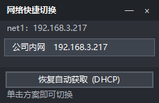

# NetSwitcher —— Windows 网络快速切换工具

一键切换网卡的 **IP 地址 / 子网掩码 / 默认网关 / DNS**，或者一键恢复为自动获取（DHCP）。
适合"公司内网 ↔ 家里 ↔ 设备调试直连"这类需要频繁改 IP 的场景。

- 单个 `NetSwitcher.exe`，双击即用，**不需要安装 .NET SDK / Python 等任何运行时**（依赖系统自带的 .NET Framework 4.x）
- 启动时通过内嵌清单申请管理员权限（改网络配置必须提权），**只需点一次 UAC**
- 三个快捷入口，都走同一套切换逻辑：
  1. **悬浮快捷面板** —— 置顶小窗，列出所有方案，**单击即切换**（推荐当"任务栏快捷入口"用）
  2. **托盘右键菜单** —— 同一份方案列表
  3. **命令行 / 快捷方式** —— `NetSwitcher.exe --apply"公司内网"`，可自己建桌面快捷方式



---

## 1. 快速开始

```
E:\dsh\NetSwitcher\dist\NetSwitcher.exe      ← 直接双击运行（会弹一次 UAC）
```

1. **刷新** —— 顶部下拉框列出本机所有网卡，自动选中正在联网的那张；下方显示它当前的 IP、掩码、网关、DNS 和获取方式。
2. 在左侧填入要切换到的 **IP / 掩码 / 网关 / DNS**（掩码也可以填 `/24`）。
3. 点 **保存为方案**，例如命名"公司内网"。
4. 勾选底部的 **显示悬浮快捷面板** —— 屏幕右下角会出现一个置顶小窗，**单击方案按钮就切换**，不需要打开主窗口。
5. 想回到自动获取：面板或顶部的 **恢复自动获取 (DHCP)**。

> ⚠️ 切换 IP 的瞬间当前网络会短暂中断（Wi-Fi 可能重连），这是 Windows 的正常行为。
> 如果你正通过远程桌面/SSH 连着这台机器，请先确认新 IP 仍然可达。

### 界面说明

| 区域 | 作用 |
| --- | --- |
| 顶部 | 选择网卡、刷新、恢复 DHCP；下方一行显示该网卡当前配置 |
| 左侧 | 静态配置输入区：IP、掩码、网关、DNS、方案名称 |
| 右侧 | 已保存方案列表，双击即切换 |
| 底部 | 立即应用（不保存）、仅应用 DNS、最小化到托盘、**悬浮面板开关**、执行结果 |

### 悬浮快捷面板

- **始终置顶**、不进任务栏；拖标题栏可移动，位置会被记住
- 面板宽度固定、高度按方案数量自适应
- 每个方案一个按钮，**单击立即切换**（面板上不弹确认框，结果在面板底部状态行和屏幕提示里显示）
- 标题栏 `—` 收起、`×` 关闭（关闭只是隐藏，勾选框会同步取消）；**双击标题回到主窗口**
- 打开主窗口时若上次是开启状态，会自动恢复显示
- 勾选状态记在 `settings.json`，退出程序后下次启动自动恢复

## 2. 功能清单

- **网卡枚举**：列出所有 IPv4 网卡，显示类型（有线/无线/回环/隧道）、连接状态、当前 IP
- **当前配置读取**：IP、掩码、网关、DNS、DHCP/静态状态；优先用系统 API，读不到时回退到 `netsh` 解析
- **切换静态 IP**：`IP + 掩码 + 网关`，网关留空表示"不设置默认网关"（会显式清掉旧网关）
- **DNS 设置**：支持多个 DNS（逗号/分号/空格分隔），留空表示自动获取
- **仅改 DNS**：保持 IP 不变，只换 DNS
- **恢复自动获取（DHCP）**：一键把 IP 与 DNS 都交回 DHCP
- **配置方案**：保存 / 载入 / 删除 / 覆盖提示；JSON 存放于 `%APPDATA%\NetSwitcher\profiles.json`
- **三个快捷入口**：悬浮面板、托盘右键菜单、命令行
- **单实例 + 进程间通信**：程序已在运行时，再次启动（或点快捷方式）不会出现第二个实例，而是把指令交给已运行的实例执行
- **结果校验**：每次执行后重新读取网卡真实状态，只有确认生效才报"成功"，失败会附带 `netsh` 原始输出
- **输入校验**：IP/掩码/网关格式错误会拦下；网卡名带空格/中文也能正确处理

## 3. 目录结构

```
E:\dsh\NetSwitcher\
├─ app.manifest           UAC 管理员清单 + DPI 感知 + 系统兼容声明
├─ build.ps1              编译脚本（调用系统自带 csc.exe，同时编出 4 个自检程序）
├─ README.md              本文档
├─ src\
│   ├─ Program.cs         入口：单实例互斥、命令行分发、命名管道收发
│   ├─ CommandLine.cs     命令行解析（--apply / --dhcp / --show / 裸方案名）
│   ├─ MainForm.cs        主窗口：网卡列表、配置输入、方案列表、托盘菜单、IPC 监听
│   ├─ SwitcherForm.cs    悬浮快捷面板
│   ├─ NetworkApplier.cs  切换核心（三个入口共用）+ 结果提示浮层
│   ├─ NetworkManager.cs  网络读写：枚举网卡、netsh 执行与解析、掩码换算
│   ├─ ProfileStore.cs    方案模型与 JSON 持久化
│   └─ SettingsStore.cs   程序设置（面板开关与位置）
├─ tests\
│   ├─ Probe.cs           只读自检：网卡枚举、netsh 解析、掩码/校验逻辑
│   ├─ UiSmoke.cs         界面自检：配置往返、窗体构建、托盘退出、命令解析、面板
│   ├─ IpcLive.cs         单实例通信的"监听方/发送方"两用程序
│   └─ IpcLiveRunner.cs   拉起两个真实进程验证通信链路
└─ dist\
    ├─ NetSwitcher.exe    最终产物（已内嵌 UAC 清单）
    ├─ probe.exe / ui-smoke.exe / ipc-live.exe / ipc-run.exe   自检程序
```

## 4. 重新编译与自检

```powershell
powershell -ExecutionPolicy Bypass -File .\build.ps1
```

脚本用 `%WINDIR%\Microsoft.NET\Framework64\v4.0.30319\csc.exe` 编译，输出 `dist\NetSwitcher.exe`
并内嵌 `app.manifest`。**若 exe 正被占用（程序还在运行），会自动改输出为 `dist\NetSwitcher_new.exe`**，
不会白编一场；退出程序后改名替换即可。

```powershell
# 只读逻辑自检（不改任何网络配置）
& .\dist\probe.exe

# 界面 / 面板自检（读写配置文件，不碰网络）；可顺便出两张界面截图
& .\dist\ui-smoke.exe --shot .\build\ui.png --panel-shot .\build\panel.png
& .\dist\ui-smoke.exe --visible          # 停留 10 秒供肉眼确认

# 单实例通信的真实双进程验证（命令要在文件沙箱之外运行）
& .\dist\ipc-run.exe "APPLY|公司内网|net1"
```

`ui-smoke.exe` 里包含这些回归测试：点叉号只收进托盘 / 托盘"退出"必须真正结束进程 /
`--apply"名字"` 等四种命令行写法 / 面板开关与勾选框联动。

## 5. 配置与绿色化

- 方案：`%APPDATA%\NetSwitcher\profiles.json`（界面里点 **配置文件** 可直接定位）
- 设置：同目录下的 `settings.json`（面板开关、面板位置等）
- 想做成绿色版 / 用另一份配置，设置环境变量即可：

```powershell
$env:NETSWITCHER_PROFILE_FILE = 'D:\Tools\NetSwitcher\profiles.json'
.\NetSwitcher.exe
```

方案是纯 JSON，可手工编辑、备份、复制到别的机器：

```json
[
  {
    "Name": "公司内网",
    "Adapter": "net1",
    "Dhcp": false,
    "Ip": "192.168.3.217",
    "Mask": "255.255.255.0",
    "Gateway": "192.168.3.1",
    "Dns": ["192.168.3.6", "8.8.8.8"]
  },
  { "Name": "自动", "Adapter": "", "Dhcp": true, "Ip": "", "Mask": "", "Gateway": "", "Dns": [] }
]
```

`Adapter` 为空表示"套用到当前正在联网的那张网卡"，所以这类方案换机器也能用。

## 6. 命令行与快捷方式

| 命令 | 作用 |
| --- | --- |
| `NetSwitcher.exe` | 打开主窗口（已有实例则把它叫到前面） |
| `NetSwitcher.exe --apply"公司内网"` | 静默套用该方案，弹一个结果框后退出 |
| `NetSwitcher.exe --apply"公司内网" --adapter"net1"` | 指定网卡套用 |
| `NetSwitcher.exe 公司内网` | 裸方案名写法，方便直接做快捷方式 |
| `NetSwitcher.exe --dhcp` | 恢复自动获取 |
| `NetSwitcher.exe --show` | 只把已有实例的主窗口叫到前面 |

想做一个桌面/开始菜单快捷方式：目标填 `"E:\dsh\NetSwitcher\dist\NetSwitcher.exe" --apply"公司内网"`。
点它会弹一次 UAC（因为程序清单要求管理员），然后静默切换并提示结果。

## 7. 关于"任务栏右键菜单"（为什么没做）

Windows 的任务栏右键菜单（Jump List）**不允许提权进程写入**。实测调用 `ICustomDestinationList`：

```
AppendCategory  -> UnauthorizedAccessException (0x80070005 E_ACCESSDENIED)
CommitList      -> UnauthorizedAccessException (0x80070005 E_ACCESSDENIED)
```

只要程序清单是 `requireAdministrator`（改网卡必须提权），这条路就走不通；
本机 `.NET Framework` 是裁剪安装，`System.Windows.Forms.JumpList` 类型甚至直接不存在。
要拿到任务栏跳转列表，只能把架构改成"主程序不提权 + 独立提权工作进程"。

因此这里改用**悬浮快捷面板**：置顶、单击即切换、位置可记忆，效果上等价于一个常驻任务栏入口，
且不需要动安全模型。如果你希望改成跳转列表方案，见 `src/Program.cs` 与 `NetworkApplier.cs` 的分层，
切换成本已经控制在一个文件内。

## 8. 实现要点（便于维护/扩展）

- **修改配置**：统一走 Windows 自带的 `netsh interface ip set/add ...`
  - `netsh interface ip set address name="网卡" static <IP> <掩码> [<网关>|gateway=none]`
  - `netsh interface ip set address name="网卡" source=dhcp`
  - `netsh interface ip set dns name="网卡" static <DNS> primary` / `add dns ... index=N`
  - `netsh interface ip set dns name="网卡" source=dhcp`
- **读取状态**：优先 `System.Net.NetworkInformation`（不受语言影响）；`netsh` 输出只作兜底。
  解析按"标签 + 取值形态"识别，**不依赖缩进**（netsh 每行都有缩进），同时支持 `:` 与全角 `：`。
- **编码坑**：`netsh` 输出代码页在不同宿主下不一致，程序**直接读子进程字节流**，
  先按 UTF-8 严格解码，失败再退回系统 ANSI 代码页，避免中文乱码导致解析失败。
- **单实例通信**：命名管道 `NetSwitcher_Command_Pipe`。监听端会先确保窗口句柄已创建，
  并在句柄就绪前重试派发——否则第一条指令会被 `BeginInvoke` 静默丢掉。
- **失败可诊断**：`netsh` 完整输出会带回界面，出错时直接看得到原因。

## 9. 已知限制

- 只处理 **IPv4**（不含 IPv6 地址配置、路由表、跃点数、WINS、代理设置）
- 网卡用**名称**匹配（如 `net1`、`WLAN 2`），重命名网卡后需手工调整方案里的网卡名
- 悬浮面板是普通置顶窗口，不是真正的任务栏控件：**会被全屏应用遮住**，且不随任务栏自动移动
- 未做"按 Wi-Fi SSID 自动切换"、"切换失败自动回滚"、"开机自动应用"（可作为下一步扩展）
- 部分虚拟网卡（VPN、Wi-Fi Direct、蓝牙网络）也在列表里，属正常现象，注意别选错
